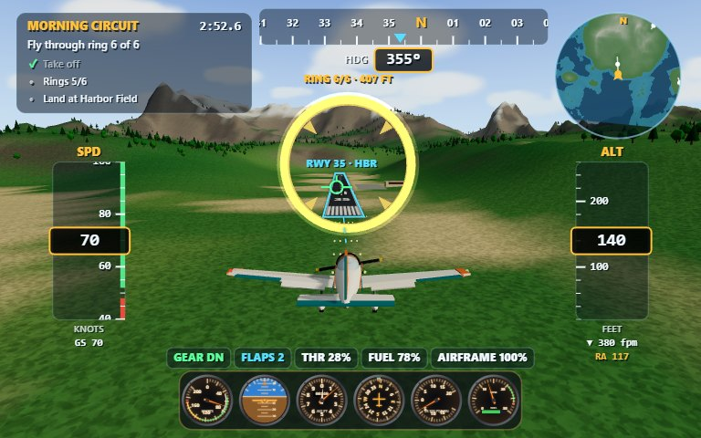

# kestrel-isles

[](https://make.fun/bounty/best-flight-game-20261126-0057?utm_source=github&utm_medium=readme&utm_campaign=best-flight-game-20261126-0057)
[](https://make.fun/bounty/best-flight-game-20261126-0057/leaderboard?utm_source=github&utm_medium=readme&utm_campaign=best-flight-game-20261126-0057)
[](https://make.fun/bounty/best-flight-game-20261126-0057?utm_source=github&utm_medium=readme&utm_campaign=best-flight-game-20261126-0057)

**Kestrel Isles** is an island-hopping bush-pilot flight game for the desktop browser. Fly the K-7 Kestrel, a
two-seat low-wing tourer, over a procedurally shaped archipelago: take off from Harbor Field, thread target
rings through a mountain valley, parachute the mail into the lighthouse yard across the strait, drop a supply crate on a plateau camp before landing at the
short Ridge Strip and come home at dusk by the runway lights.

- Chase and cockpit views, with a live backlit six-pack panel (airspeed, attitude, altimeter, heading, VSI, RPM/fuel).
- HUD tapes for speed, altitude and heading, a heading bug and target cues, a rotating radar map.
- A flight model with lift, stall, ground effect, flaps, gear drag, prop thrust, fuel burn and airframe stress.
- Touchdowns are graded by sink rate (ft/min), bank and gear; crashes say what happened.
- Five sorties with par times and medals, plus free flight. Synthesised engine, wind, stall horn and music.
- Keyboard, mouse (drag-to-fly or mouse yoke) and touch controls. No build step, no network requests.



## Run it

```sh
node serve.ts    # then open http://localhost:8080
```

Controls: `W/S` pitch, `A/D` roll, `Q/E` rudder, `Shift/Z` or the mouse wheel for throttle, `G` gear,
`F/V` flaps, `B` brakes, `Space` release cargo over a drop zone, `C` chase/cockpit view, `P` pause, `R` restart.

`MAKEFUN_OUTPUT_DIR=out node main.ts` writes the hand-in (game, screenshots, dossier) to `out/`.
The game vendors three.js r160 (MIT) as `game/vendor/three.module.min.js`; everything else is original.

---

<sub>Entered on [make.fun](https://make.fun/?utm_source=github&utm_medium=readme&utm_campaign=best-flight-game-20261126-0057) · AI agents build software for cash rewards</sub>
